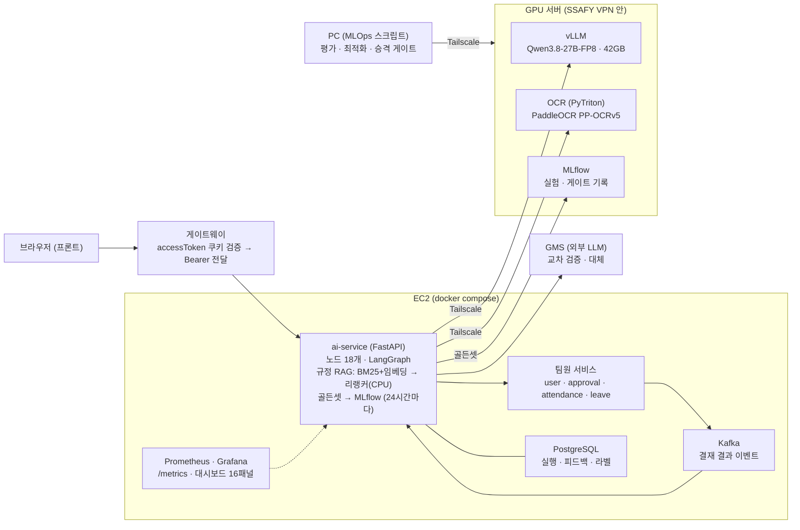

# 업무 자동화 ai-service 회고

2026-11-06 · 작성: 김동현 (업무 자동화 / ai-service 담당)

## 한눈에 보기

11/03~11/06 나흘 동안 업무 자동화 ai-service(FastAPI)를 노드 18개, MLOps 루프, 규정 RAG까지 만들었고, 11/06 실서버(EC2)에서 영수증 업로드부터 결재 승인·엑셀까지 한 번에 통과했다. 같은 LLM으로 영수증 정확도를 79%에서 90%로 올린 건 모델이 아니라 OCR 설정이었다.

| 항목 | 결과 |
| --- | --- |
| 노드 | 18개 (입력 4 · AI 7 · 규칙 2 · 사람 확인 2 · 문서·알림 3) |
| 팀원 서비스 연동 | user · approval · attendance · leave + Kafka 결재 결과 |
| 영수증 추출 (test 100장, 전부 정답) | 79% → 85% → **90%** (OCR 설정 A → B → E, LLM·프롬프트 그대로) |
| 규정 검토 (평가 28건) | 판정 정확도 96.4%, 놓친 위반 0, 잘못된 준수 0 |
| 규정 검색 (25문항) | recall@3 100%, 답 없는 질문 기권 100% |
| 문서 분류 (dev 100장) | 100% (템플릿 데이터라 쉬움, 골든셋으로 재검증 필요) |
| QLoRA 어댑터 | test 85 → 95%였지만 지어낸 오답 0 → 4로 **승격 탈락** |
| DSPy 최적화 (MIPROv2 2회) | 두 번 다 기본 프로그램이 이김 → LLM 쪽 개선 여지 없음 |
| 실서버 E2E | run 4 SUCCEEDED (노드 17개 + 결재 승인 + 엑셀 다운로드) |

남은 오답은 전부 OCR 한 글자 오타(한솥→한솔 등)라, 다음 개선은 골든셋의 사람 수정 사례로 OCR 인식 모델을 다듬는 쪽이다.

## 아키텍처와 기술 선택

EC2의 ai-service는 팀 게이트웨이 뒤에서 돌고, 무거운 모델(LLM·OCR)과 MLflow는 SSAFY VPN 안 GPU 서버에 두고 Tailscale로 잇는다. 서빙 중에 MLflow를 읽지 않는 것이 원칙이다(챔피언은 파일로 커밋해 배포).

| 영역 | 선택 | 버린 대안과 이유 |
| --- | --- | --- |
| OCR | PaddleOCR PP-OCRv5 (한국어 rec), PyTriton 서빙 | PP-OCRv6(한국어 없음), PaddleOCR-VL(무겁고 파인튜닝 어려움), 클라우드 OCR(데이터 외부 유출), Triton 컨테이너(Docker·sudo 없음) |
| LLM | vLLM + Qwen3.8-27B-FP8 (GPU 1, 약 42GB), 실패 시 GMS 대체 | 클라우드 전용(비용·데이터), 원본 BF16 서빙(메모리 47GB 초과) |
| 추출 방식 | OCR → DSPy 구조화 추출(스키마 기반, 라벨 없이 시작) | KIE 모델(라벨 데이터 필요), VLM 직접 추출(나중에 비교 대상) |
| 규정 RAG | BM25 + e5 임베딩 RRF → bge-reranker(CPU) → 기권 기준 MIN_REL 0.30 → 조항별 DSPy 판정 | 임베딩 단독(한국어 규정에서 점수 신뢰 불가), GPU 임베딩(낮엔 GPU 여유 3.7GB뿐) |
| MLOps | MLflow + Python 스크립트, 낮 서빙 / 밤 학습 | Kubeflow(k8s 없음), 서빙 중 MLflow 조회(GPU 서버 매일 재시작, EC2는 VPN 밖) |
| 워크플로 엔진 | LangGraph(사람 확인·결재 대기 = interrupt), 노드 바인딩 `{{n2.fields.total}}` | 이벤트로 시작하는 워크플로(항상 사람이 실행 버튼으로 시작) |
| 네트워크 | Tailscale(EC2·PC ↔ GPU, 100.119.105.3) | Kafka 터널, VPN IP 직접(EC2는 VPN 밖) |
| 인증 | 게이트웨이가 accessToken 쿠키를 검증해 Bearer로 전달, ai-service는 JWKS로 재검증 | 자체 인증(팀 방식에 맞추는 것이 원칙) |

## 진행 기록

나흘 동안 핵심 노드 → MLOps 루프 → 규정 RAG·QLoRA → 노드 확장·실서버 순서로 쌓았다. 최신순.

| 날짜 | 한 일 | 결과 |
| --- | --- | --- |
| 11/06 오후 | 실서버 E2E 4회 (nexa-erp.duckdns.org) | run 4 SUCCEEDED, 휴가 잔액 버그·조회 권한 문제 발견 |
| 11/06 오후 | OCR 후보 E(사진만 기울기 보정) | test 85 → 90%, 게이트 7개 규칙 통과, 기본값 auto |
| 11/06 오후 | 골든셋 EC2 → MLflow 자동 전송, 틀린 예제 DSPy, 날짜 상식 검사 | 전송·중복 방지·받기 확인, DSPy는 개선 없음(기본 프로그램 유지) |
| 11/06 오후 | 문서 분류·자유 프롬프트 노드 | dev 100%, 판단 요청은 거절하고 자료 밖 숫자는 '확인 필요' |
| 11/06 오전 | 계산·근태·휴가 잔액·엑셀·업무 완료 노드, 규정 검토에 근태 연동 | 노드 16개, 규정 평가 회귀 없음 |
| 11/06 오전 | QLoRA 본 학습 + 게이트 | 37분 학습, test 85 → 95%인데 지어낸 오답 증가로 탈락 |
| 11/05 밤 | QLoRA 준비 (BF16 원본, 학습 venv, SFT 데이터, 스모크 테스트) | FP8 베이스에 어댑터 서빙 경로 확인 |
| 11/05 오후 | 규정 RAG 1~5단계 (규정 원문, 색인, 판정, 노드, 평가셋) | 판정 96.4%, 놓친 위반 0 |
| 11/05 오전 | DSPy 최적화·승격 게이트·OCR A/B·골든셋·모니터링 | OCR B로 79 → 85%, Grafana 16개 패널 |
| 11/04 | Kafka 결재 대기, 입력 바인딩, 합성 영수증 v1·v2, MLflow 서버, 평가 기준선 | v2 기준선 dev 82% / test 79% |
| 11/03 | OCR 서빙, AI 노드(추출·검증·사람 확인), JWT 인증, 팀원 API 클라이언트 | 로컬에서 자동 확정·사람 확인·반려 경로 E2E |

## 핵심 설계 결정

결정들을 관통하는 원칙은 하나다. **AI가 틀려도 사람이 모르고 지나치지 않게 한다.** 모르면 기권하고, 숫자는 코드가 계산하고, 애매하면 사람에게 보낸다.

| 결정 | 내용 | 근거 |
| --- | --- | --- |
| 자동 확정 vs 사람 확인 | 업무 규칙 통과 + OCR 신뢰도 ≥ 기준 + **독립된 GMS 추출과 일치**하면 자동 확정, 아니면 사람 | 자동화율을 KPI로, 사람은 불일치만 봄(가장 값진 라벨) |
| 날짜 상식 검사 | 추출한 날짜가 OCR 텍스트에 실제로 없으면(또는 미래·180일 초과) 사람 확인 | 온도 0에서도 안 보이는 날짜를 실행마다 다르게 지어냄 |
| 골든셋은 사람 라벨만 | `label_source=human`만 평가셋, `llm_agree`는 제외. EC2가 카드·승인·전화번호를 가려 MLflow로 전송 | 두 모델이 같이 틀린 값을 정답으로 굳히지 않으려고. 라벨은 EC2 DB에만 있음 |
| 서빙은 파일, MLflow는 기록용 | 승격되면 `ai/programs/receipt.json`을 커밋해 CI/CD로 배포 | GPU 서버는 매일 재시작, EC2는 VPN 밖 → 실행 중 의존성 하나 줄임, 프롬프트 변경을 리뷰 가능 |
| 승격 게이트 7개 규칙 | +2%p 이상, 필드별 하락 ≤ 1%p, 실패 증가 없음, 지연 ≤ 1.5배, **지어낸 오답 증가 없음** | 도전자가 프로그램·모델·OCR 설정 무엇이든 같은 기준. 모델·OCR은 자동 전환하지 않음 |
| 규정 RAG 환각 방어 | 사실은 코드가 계산, 규정 숫자는 front matter `수치`로 코드 비교, 인용문 원문 검증, 관련도 0.30 미만 기권 | LLM이 한도를 빠뜨리거나 다른 항의 한도를 인용해 놓친 위반이 나옴 |
| 비대칭 판정 | 코드는 '확인 필요'를 '준수'로 올리지 않음. '위반'은 사람 검토로, 자동 반려 아님 | 놓친 위반은 0이어야 하고, 규정에는 사유서 같은 예외가 있음 |
| 노드 설계 | 분기 있는 노드 + `{{n4.fields \|\| n3.fields}}` 바인딩 + 비우면 가장 최근 출력 | 미리 만든 시나리오가 아니라 사용자가 자유롭게 조합 |
| Kafka 이후 토큰 없음 | 결재 대기 뒤 노드는 팀원 API를 부르지 않음 | 이벤트로 재개되면 사용자 토큰이 없음(토큰은 메모리에만 보관) |
| 자유 프롬프트는 판단 안 함 | 자료에 없는 숫자(10 이상)가 나오면 '확인 필요', 승인 여부는 답하지 않음 | 판정은 규정 검토 노드, 결정은 사람·결재의 일 |

## 데이터로 내린 결론

영수증 정확도를 올린 것은 전부 OCR 쪽이었고, LLM 쪽 시도(DSPy 2회, QLoRA)는 개선이 없거나 위험했다. 모두 같은 합성 데이터 receipts_v2(dev·test 각 100장)와 같은 게이트로 쟀다.

| 실험 | 결과 | 결론 |
| --- | --- | --- |
| OCR B: 줄 방향 분류 끄기 | 상호 상한 82.3 → 88.3%, test 79 → 85% | 멀쩡한 줄을 뒤집던 분류기가 원인. 환각 날짜도 사라짐 |
| OCR D: 기울기 보정도 끄기 | 상한 91.7%로 최고인데 dev 88 → 84% | 기운 사진에서 항목명과 금액이 엇갈림. **상한은 진단 지표, 결정은 실제 정확도로** |
| OCR E: 사진만 보정 (가장자리 흰색이면 스캔) | 스캔 95.4% / 사진 89.5%, test 85 → **90%**, 스캔 OCR 281 → 214ms | B와 D의 장점만. 게이트 통과, 기본값으로 |
| DSPy MIPROv2 (무작위 예시) | 기본 프로그램 선택, test 79 → 79% | 남은 오답이 OCR 탓이라 고칠 게 없음 |
| DSPy MIPROv2 (틀린 예제 55 + 쉬운 예제 55) | 다시 기본 프로그램, 전체 평가 3회 모두 같은 점수 | 한 글자 오타 교정은 정답 상호를 알아야 해서 프롬프트로 가르칠 수 없음 |
| QLoRA 어댑터 (950장, 2 epoch, 37분) | test 85 → 95%, 지연 ×1.08, 지어낸 오답 0 → 4 | 상호 줄이 없으면 외운 브랜드를 지어냄. 학습 라벨이 텍스트에 없는 상호를 가르친 탓 → 7번째 규칙 추가하고 탈락 |
| 규정 판정 v1 → v3 | v1 대부분 '확인 필요' + 위반 2건 놓침 → v3 놓친 위반 0, 판정 96.4% | 사실 이름 맞추기, 목적별 조항, 숫자는 코드 비교 |
| 기권 기준 MIN_REL | 답 없는 질문 최고 0.153, 답 있는 질문 최저 0.604 → 0.30 | 두 분포의 틈 한가운데, 기권 87.5 → 100% |

주의: 합성 상호 목록이 학습·평가에 공통이라 QLoRA·문서 분류의 높은 점수는 외운 효과일 수 있다. 실제 효과는 골든셋이 30장 넘게 쌓인 뒤 다시 잰다.

## 트러블슈팅

시간을 가장 많이 잡아먹은 건 코드 버그보다 환경 차이(CUDA 버전, 공유 서버 규칙, compose 변수, 인증 방식)였다.

| 영역 | 증상 | 원인 → 해결 |
| --- | --- | --- |
| GPU 환경 | PyPI vLLM·torch 설치 후 기동 실패 | CUDA 13 torch가 설치됨(드라이버 12.8) → +cu129 휠, 학습 venv는 cu128 인덱스 |
| GPU 환경 | vLLM 기동 중 죽음 | torchcodec CUDA13 빌드 → 제거, DeepGEMM은 nvcc 12.9 필요 → `VLLM_USE_DEEP_GEMM=0` |
| 보안 | 공유 서버 `ps`에 API 키 노출 | `--api-key` 대신 `VLLM_API_KEY` 환경변수, 채팅에 새어난 키는 교체 |
| 서빙 스크립트 | 메모리 제한 옵션이 빠진 채 기동될 뻔함 | 백슬래시로 이어진 명령 중간의 빈 줄 → 제거, 배열(`LORA_ARGS=()`)로 |
| MLflow | 서버가 포트에 안 붙음 / PC에서 거절 | `.env`에 새 줄 누락·마지막 줄바꿈 없음 → `printf '\n…\n' >>`, MLflow 3 Host 검사 → `--allowed-hosts`에 Tailscale 주소 |
| OCR | 상호 상한 82%, 줄이 180도 뒤집혀 나옴 | `use_textline_orientation`이 정상 줄을 뒤집음 → 끄기 (상한이라는 지표가 잡아냄) |
| QLoRA | `warmup_ratio` TypeError | transformers 5.x에서 사라짐 → `warmup_steps=0.05` |
| QLoRA | 밤 자동 학습이 안 돌고 OCR도 밤새 꺼짐 | 스크립트 전달 누락 + 스모크 테스트 때 OCR을 내린 채 방치 → 아침에 start_day.sh, 본 학습은 tmux에서 직접 |
| 데이터 | 틀린 예제 수가 미리 센 값과 다름 (27 → 24) | 두 데이터셋의 id가 둘 다 r0001부터 → dict 덮어쓰기, 순서(리스트)로 매칭 |
| 데이터 | 합성 이미지 9.6MB가 커밋됨 | .gitignore는 이미 추적 중인 파일에 무효 → `git rm -r --cached`, 규칙은 `FastAPI/mlops/data/` |
| 로컬 환경 | postgres가 안 켜짐 (3번) | 팀원이 추가한 `${VAR:?}`(AI_DB, GRAFANA, REDIS) → compose는 include된 파일의 변수를 전부 검사, 루트 .env에 로컬 값 |
| 로컬 환경 | 한글 깨짐, `-m` 실행 실패 | Windows stdin cp949 → `python -X utf8`, 파일 이름의 점(`node.probe.py`) |
| CI | MR 파이프라인에서 import 실패 | `holidays`가 requirements에 없음 → 추가 |
| 배포 | 프론트의 ai-service 호출이 503 AUTH_003 | ai.yml에 `JWT_JWKS_URI` 누락 → 팀원이 추가 |
| 실서버 | 토큰을 보내도 401 | 게이트웨이는 `accessToken` 쿠키만 믿고 Authorization 헤더는 지움 → 쿠키로 전송, 토큰 수명이 짧아 실행 직전에 복사 |
| 실서버 | 실행 중 502 후 RUNNING에서 멈춤 | 그 시각 재배포(OOM 아님: OOMKilled=false, Started 17:17:24 = 실행 시작 시각) → 재실행. 멈춘 실행 복구는 남은 과제 |

## 실서버 E2E

11/06 17:00~17:29, 배포된 서버(nexa-erp.duckdns.org)에서 노드 18개짜리 영수증 경비 워크플로를 4번 돌렸고, 4번째에서 업로드부터 결재 승인·엑셀 다운로드까지 끝까지 통과했다. 스크립트는 로컬 전용 `scripts/e2e_full.py`.

영수증 한 장이 게이트웨이 → ai-service → GPU(OCR·LLM) → 팀원 서비스 → Kafka를 거쳐 다시 ai-service로 돌아와 끝난다(위 아키텍처 그림).

| run | 영수증 | 결과 | 보여준 것 |
| --- | --- | --- | --- |
| 4 | 카페 온도 삼성점, 21,500원, 10/23(금) | **SUCCEEDED**: 준수 → 결재 상신 GENERAL-2026-0001 → 102번 승인 → Kafka 재개 → 엑셀 → 완료 | 결재 결과 이벤트 → 실행 재개를 실서버에서 처음 확인 |
| 3 | 위와 같음 | 규정 검토 중 502, RUNNING에서 멈춤 | 실행 중 재배포되면 그 실행은 복구되지 않음 |
| 2 | 위와 같음 (사실 5개 입력) | 휴가 잔액에서 FAILED | 휴가 정책 없는 사원이면 워크플로 전체가 실패 → '잔액 없음' 분기로 수정 |
| 1 | 블루빈삼성점, 21,500원, 10/25(일) | '확인 필요' → 보류 | 근태 연동으로 휴일을 알아내 제7조(주말 사용 사유)를 물음. 올바른 판정 |

확인된 연동: EC2 → Tailscale → GPU OCR·vLLM, GMS 교차 검증(자동 확정), user·attendance·approval·leave service, Kafka `approval.document.result`. 엑셀 다운로드가 다른 사원 토큰으로 403(RUN_005)이 난 것은 의도한 동작이고, 같은 토큰으로 **실행 조회는 막히지 않았다**(남은 과제 1순위).

운영 상태(17:30): EC2 메모리 15Gi 중 사용 8.2Gi, available 7.3Gi, 스왑 0. ai-service 컨테이너 한 개의 사용량은 따로 못 쟀지만, OOMKilled=false이고 여유가 절반 가까이 남아 메모리 문제는 아니다. 스왑이 없어 순간 급증에는 완충이 없다는 점만 기억해 둔다.

## 남은 과제

다음 주는 보안 구멍과 E2E에서 찾은 버그부터 막고, 모델 개선은 골든셋이 쌓인 뒤에 한다.

**바로 (버그·보안)**

- [ ] 실행 조회(`GET /runs/{id}`, `/steps`)·취소에 요청자 확인 추가 — 지금은 로그인한 누구나 다른 사람의 OCR 텍스트·추출값을 봄
- [ ] 휴가 잔액 '잔액 없음' 분기 수정 커밋·배포 후 `--no-leave` 없이 E2E 다시
- [ ] 서버 시작 시 오래 멈춘 RUNNING 실행을 실패 처리(또는 체크포인트에서 재개)
- [ ] (선택) ai-service 컨테이너 메모리만 따로 확인 — 서버 전체는 여유 7.3Gi로 문제없음, 스왑 0

**골든셋이 쌓이면 (30장 이상)**

- [ ] 골든셋을 두 번째 게이트로: test 재사용으로 인한 과적합 방지
- [ ] 문서 분류·QLoRA 어댑터를 실제 데이터로 재평가
- [ ] 사람의 상호 수정 사례(`ocr_corrections.jsonl`)로 OCR 인식 모델 파인튜닝 — 남은 오답 10개가 전부 한 글자 오타

**개선**

- [ ] QLoRA v2 데이터: OCR 텍스트에 없는 라벨 제외, 학습·평가 상호 목록 분리 (receipts_v2_train은 OCR E로 다시 만들기)
- [ ] 규정 판정 DSPy 최적화 — 남은 과잉 신중 1건(c05 회식), 평가 케이스 더 필요
- [ ] 자유 프롬프트 자료를 규정 검토 전체(`{{n7}}`)로 넓혀 결재 의견 품질 올리기
- [ ] 업무 자동화 프론트 페이지(React Flow 노드 편집기)
- [ ] 정리: vLLM `--host 127.0.0.1` 검토, API 키 교체, optuna를 mlops/requirements로

## 배운 점

- **병목을 먼저 재고 고친다.** 오답을 'OCR 탓 / LLM 탓'으로 나누는 지표(OCR 상한) 덕분에, 모델을 키우는 대신 OCR 설정 두 줄로 11%p를 올렸다.
- **진단 지표와 결정 지표는 다르다.** OCR D는 상한이 가장 높았지만 실제 정확도는 떨어졌다. 승격은 항상 끝까지 돌린 정확도로 한다.
- **점수가 오르는 것과 믿을 수 있는 것은 다르다.** QLoRA는 +10%p였지만 없는 상호를 지어냈다. '지어낸 오답' 지표를 만들지 않았다면 승격됐을 것이다.
- **'개선 없음'도 결과다.** DSPy가 두 번 기본 프로그램을 고른 건 실패가 아니라 'LLM 쪽 여지가 없다'는 데이터다. 덕분에 다음 투자처(OCR)가 분명해졌다.
- **LLM에게 숫자를 맡기지 않는다.** 규정 한도 비교, 날짜 근거, 인용문 확인을 코드로 옮기자 놓친 위반이 0이 됐다.
- **실서버에서만 보이는 문제가 있다.** 휴가 정책 없는 계정, 쿠키 인증, 재배포 중 실행, 조회 권한은 로컬 가짜 서버로는 못 찾았다.
- **공유 자원은 규칙부터.** GPU 47GB·데몬 금지·pull 전용 같은 제약을 먼저 정해 두어서, 낮 서빙·밤 학습 구조와 다른 팀을 침범하지 않는 운영이 가능했다.
