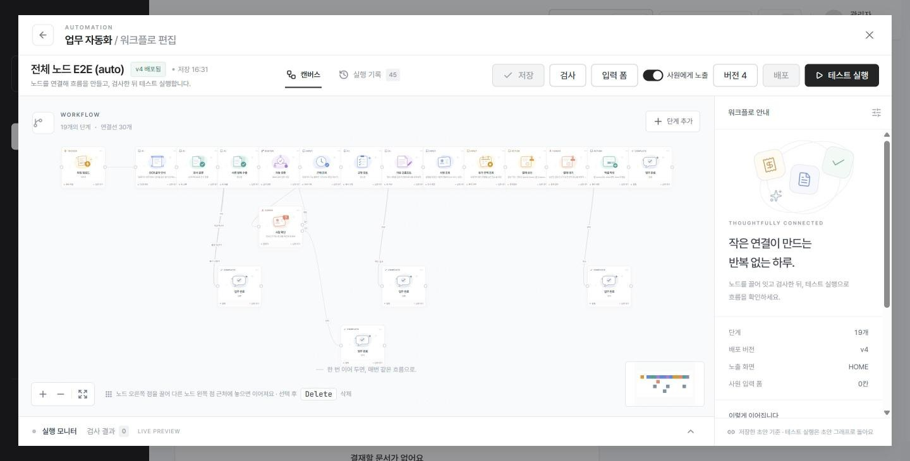
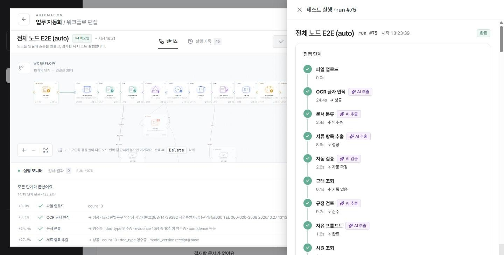
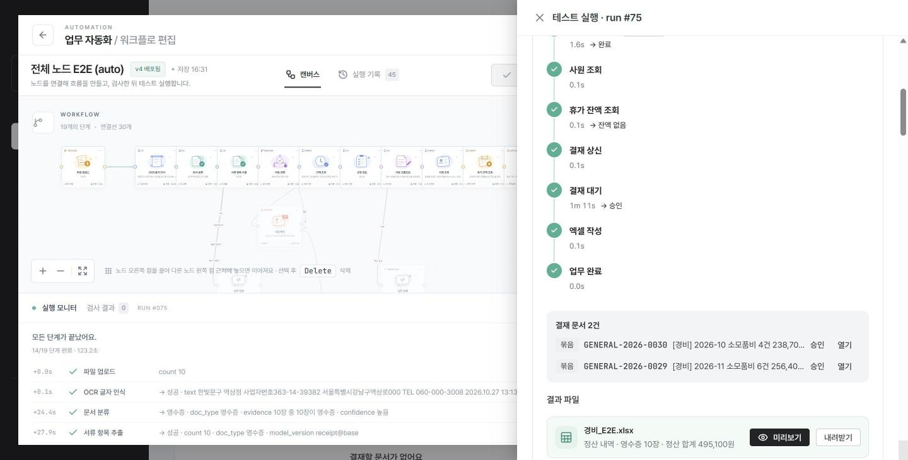
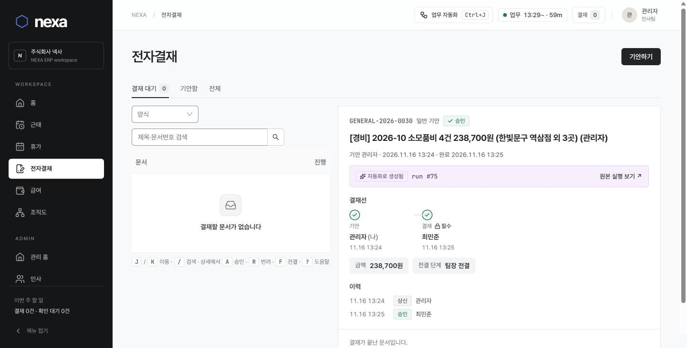
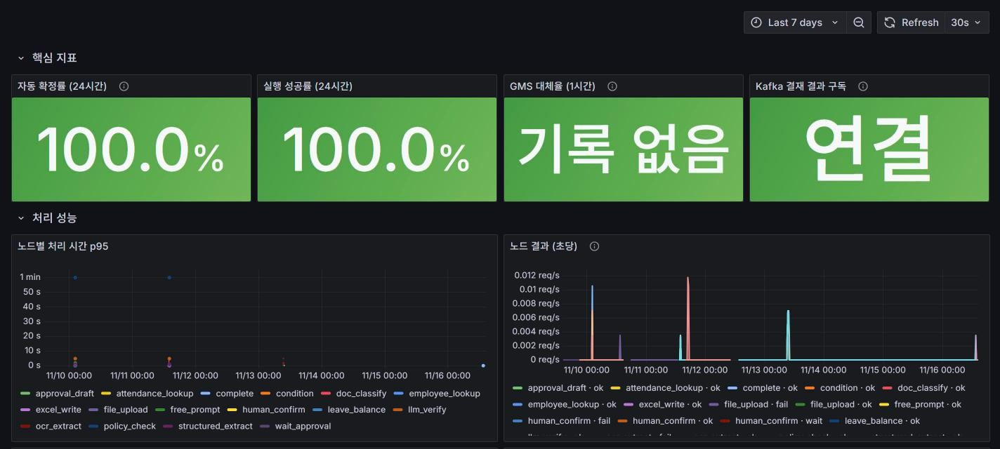
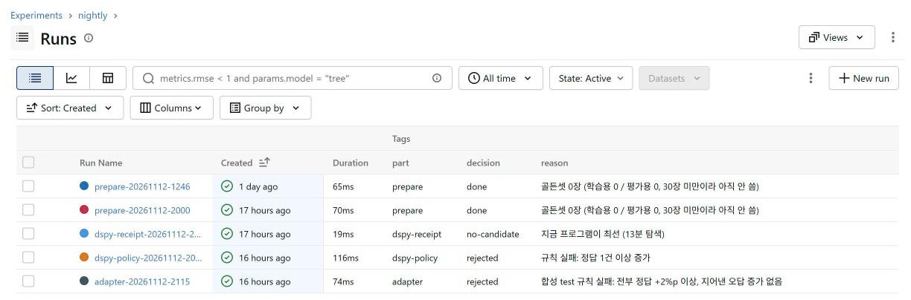
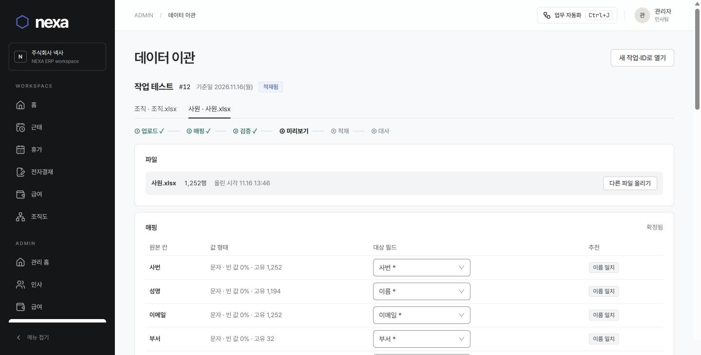
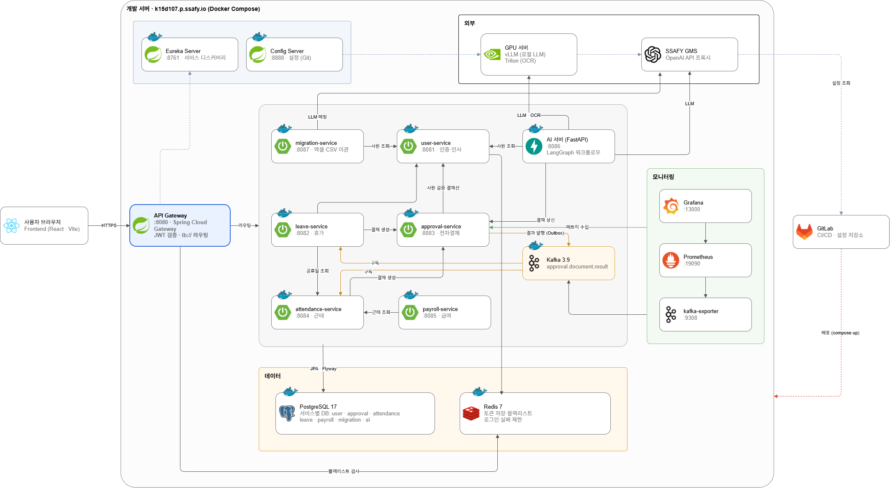
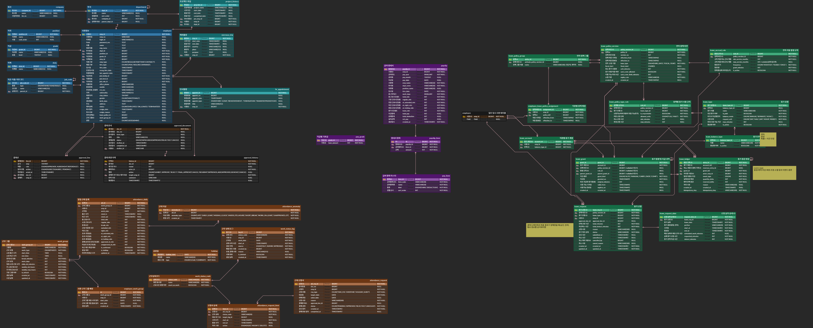

<h1 align="center"> NEXA : 업무 자동화 커스터마이징과 이지 마이그레이션까지 갖춘 HR ERP </h1>

  

 

## 프로젝트 소개

**"반복은 흐름에 맡기고, 중요한 일에 집중하세요."**

NEXA는 근태·휴가·전자결재·급여·인사를 마이크로서비스로 제공하는 사내 ERP입니다.
회사가 쓰던 엑셀을 양식 변환 없이 그대로 옮겨 오는 **데이터 이관**과, 영수증 경비 정산 같은 반복 업무를 노드로 조립해 실행하는 **AI 업무 자동화**를 함께 제공합니다.

### 개발 배경 및 필요성

- **번거로운 데이터 이관**: 회사마다 엑셀 양식이 달라, ERP를 도입하려면 컬럼 재배치·코드 값 치환·날짜 형식 정리를 사람이 직접 해야 합니다.
- **장애에 약한 업무 시스템**: 서비스 하나가 멈추면 출퇴근·결재·급여까지 함께 멈추고, 결재 결과 같은 이벤트가 유실되거나 중복 처리될 수 있습니다.
- **반복되는 경비 처리**: 영수증 확인 → 규정 찾기 → 기안 상신 → 정산서 작성을 매번 사람이 손으로 처리합니다.

이 문제를 **안전한 이관 · 장애에 강한 서비스 · AI 업무 자동화** 세 가지로 해결하기 위해 NEXA를 개발했습니다.

### 주요 기능

####  AI 업무 자동화

- **노드 기반 워크플로 빌더**: 파일 업로드·OCR·문서 분류·항목 추출·규정 검토·사람 확인·결재 상신·엑셀 작성 등 **노드 18종**을 연결해 업무 흐름을 만들고, 검사·테스트 실행 후 배포합니다.
- **노드 사이 데이터 연결**: `{{노드id.출력키}}`로 앞 노드의 출력을 참조하고, 실행 시점에 실제 값으로 바꿔 넣습니다.
- **영수증 자동 처리**: PaddleOCR로 글자를 읽고 로컬 LLM(Qwen, vLLM)과 DSPy로 상호·날짜·금액·품목을 추출합니다. 규칙·OCR 신뢰도 검사 후 애매한 장만 외부 LLM(GMS)으로 교차 검증해 **자동 확정 / 사람 확인**으로 나눕니다.
- **규정 RAG 검토**: BM25 + 문장 임베딩 하이브리드 검색과 재정렬(bge-reranker)로 근거 조항을 찾아 **준수 / 위반 / 확인 필요**로 판정합니다. 한도 금액 비교와 인용 문장 검증은 코드가 하고, 근거가 없으면 답하지 않습니다.
- **멈췄다 이어서 실행 (LangGraph)**: 조건 분기로 다음 단계를 고르고, 사람 확인·결재 대기에서는 상태를 Postgres 체크포인터에 저장한 채 멈춥니다. Kafka로 결재 결과가 오면 멈춘 노드부터 다시 실행합니다.
- **매일 밤 모델 개선 (MLOps)**: DSPy MIPROv2로 프롬프트를, QLoRA로 LLM 어댑터를 학습하고 MLflow 자동 승격 게이트(정확도·지어낸 오답·골든셋)를 통과한 것만 반영합니다. 승격 후 사람 수정률이 기준보다 오르면 이전 모델로 자동 롤백합니다.
- **서비스 모니터링**: Prometheus + Grafana로 자동 확정률·실행 성공률·노드별 처리 시간·LLM 호출을 확인합니다.

####  데이터 이관

- **원본 그대로 업로드**: 회사 엑셀을 양식 변환 없이 올리면 모든 시트와 수식을 그대로 읽습니다.
- **컬럼 자동 매핑**: 이름이 달라도 사전과 LLM 추천으로 매핑합니다. LLM에는 실제 값 대신 **값의 모양**(`2024-03-02` → `9999-99-99`)만 보내 개인정보를 외부로 내보내지 않습니다.
- **엑셀 수식 검사**: 열마다 가장 많이 쓰인 수식 패턴을 기준으로, 숫자로 덮어쓴 칸이나 다른 행을 참조하는 수식을 찾아냅니다.
- **기준정보 자동 생성**: 파일에 적힌 직급·호봉으로 코드표를 만들고, 판단할 수 없는 경우에는 적재를 막습니다.
- **검증 결과**: 가상 인물 데이터(Nemotron-Personas-Korea)로 만든 엑셀에서 **직원명부 오류 검출률 96.6%**(730건 중 705건), **컬럼 매핑 정답률 94.3%**(193개 중 182개).

####  MSA 기반 ERP

- **근태·휴가·전자결재·급여·인사** 서비스를 분리하고, 조직도 + 위임전결 규정으로 **결재선을 자동 생성**합니다.
- 바로 답이 필요한 요청은 REST, 언제 끝날지 모르는 결재 결과는 **Kafka**로 전달합니다.
- **Transactional Outbox**로 이벤트 유실을 막고, 받는 쪽은 **멱등 처리와 DLT**로 중복·실패를 처리합니다.
- 응답이 유실되면 **결과 불명**으로 남겨 두고, 같은 요청 키로 다시 조회해 복구합니다.

### 기대 효과

- **직원 · 입력은 AI가, 사람은 확인만**: 영수증 업로드 한 번으로 정산, 결재 진행 상황을 한눈에 확인
- **결재자 · 근거를 보고 빠르게 판단**: 결재 전에 규정 위반 여부와 근거 조항을 함께 제시, 누가 결재해도 같은 기준 적용
- **회사 · 위반은 막고, 도입은 가볍게**: 엑셀 이관 도구로 도입 비용 절감, 1인 1세션·로그인 잠금 보안

 

## 주요 기능 화면

### 업무 자동화

| 워크플로 빌더 | 실행 진행 상황 |
| :---: | :---: |
|  |  |
| 노드 19개를 연결한 경비 정산 워크플로. 분기마다 다음 노드가 정해집니다 | 영수증 10장: OCR → 문서 분류 → 항목 추출 → 자동 검증(자동 확정) → 규정 검토(준수) |

| 실행 결과 | 자동으로 상신된 결재 문서 |
| :---: | :---: |
|  |  |
| 결재 대기에서 멈췄다가 승인 결과를 받아 이어서 실행 → 결재 문서 2건 · 정산 엑셀 생성 | 결재 문서에 생성한 실행(run)이 연결되어 원본 실행으로 바로 이동 |

| 서비스 모니터링 (Grafana) | 밤 학습 기록 (MLflow) |
| :---: | :---: |
|  |  |
| 자동 확정률 · 실행 성공률 · GMS 대체율 · Kafka 구독 상태 · 노드별 처리 성능 | 데이터 준비 → DSPy 최적화 → QLoRA 어댑터 단계별 실행과 승격 판정·사유 |

### 데이터 이관

업로드 → 매핑 → 검증 → 미리보기 → 적재 → 대사 순서로 진행합니다. 원본 칸마다 값 형태(빈 값 비율·고유 값 수)를 보여 주고 대상 필드를 추천합니다.

 

## 기술 스택

- **Frontend**: React 18, TypeScript, Vite, React Router, TanStack Query, Zustand, React Flow(@xyflow/react), Axios
- **Backend**: Java 21, Spring Boot 4, Spring Cloud (Gateway · Eureka · Config), Spring Data JPA, Flyway, Spring Kafka
- **AI**: FastAPI, LangGraph (Postgres Checkpointer), DSPy, vLLM (Qwen + LoRA 어댑터), PaddleOCR (PyTriton), fastembed (임베딩 · bge-reranker), MLflow, QLoRA (PEFT · bitsandbytes)
- **Data**: PostgreSQL 17, Redis 7, Kafka 3.9
- **Infrastructure**: Docker Compose, GitLab CI/CD, Prometheus, Grafana, kafka-exporter, Tailscale (GPU 서버 연결)

 

## 시스템 구성도

 

## ERD

 

## 팀 소개

|  이름  |      역할      |
| :----: | :------------: |
| 황문규 | Leader / Backend |
| 박성현 |    Backend     |
| 황우찬 |    Backend     |
| 김동현 |  Backend / AI  |
| 김승환 | Backend / Data |
| 강석진 |     Infra      |
